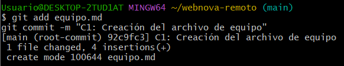
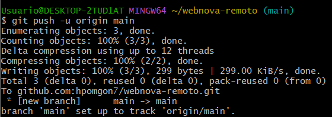
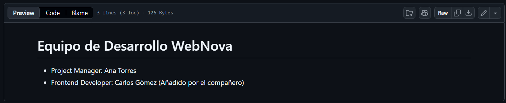
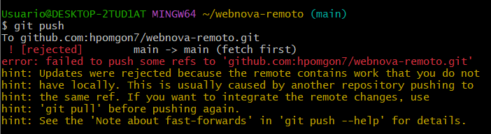
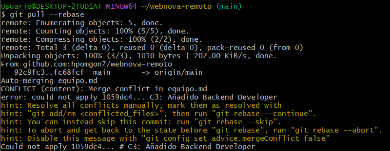
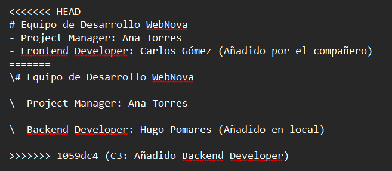
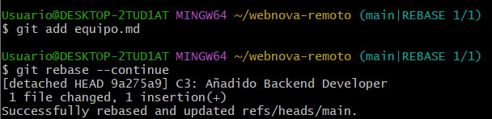
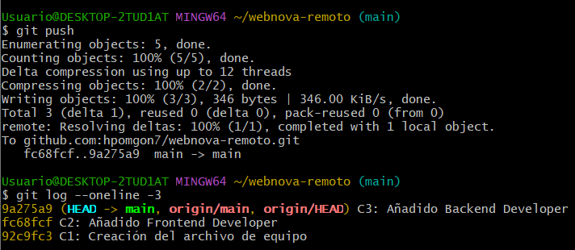
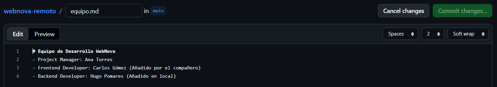

# Práctica 5. Colaboración en GitHub y resolución de conflictos remotos

## 1. Objetivo

En esta práctica he simulado que dos personas trabajaban sobre el mismo archivo. Una hacía cambios desde GitHub y la otra desde el ordenador. La idea era provocar un error al subir los cambios y después solucionarlo sin perder el trabajo de ninguna de las dos.

---

## 2. Creación del repositorio

Primero creé la carpeta `webnova-remoto` e inicialicé el repositorio desde Git Bash:

```bash
mkdir webnova-remoto
cd webnova-remoto
git init
```

Después creé `equipo.md` con estos datos:

```md
# Equipo de Desarrollo WebNova
- Project Manager: Ana Torres
```

Hice el primer commit con:

```bash
git add equipo.md
git commit -m "C1: Creación del archivo de equipo"
```



Creé un repositorio vacío en GitHub llamado `webnova-remoto`, lo conecté mediante SSH y subí la rama `main`:

```bash
git remote add origin git@github.com:hpomgon7/webnova-remoto.git
git push -u origin main
```



---

## 3. Cambio hecho desde GitHub

Para simular el trabajo del compañero, entré en GitHub y edité `equipo.md` desde la web. Añadí esta línea:

```md
- Frontend Developer: Carlos Gómez (Añadido por el compañero)
```

Guardé el cambio con el commit `C2: Añadido Frontend Developer`.



En ese momento GitHub ya tenía una versión más reciente del archivo, pero yo todavía no había descargado ese cambio en mi ordenador.

---

## 4. Modificación local y error al subir

Sin actualizar el repositorio local, abrí `equipo.md` en el ordenador y añadí mi propio puesto como Backend Developer, en vez del de Frontend Developer:

```md
# Equipo de Desarrollo WebNova
- Project Manager: Ana Torres
- Backend Developer: Hugo Pomares (Añadido en local)
```

Después hice el commit:

```bash
git commit -a -m "C3: Añadido Backend Developer"
```

Al intentar subirlo con `git push`, Git rechazó la operación.



En la terminal apareció `[rejected]` junto a `fetch first`. Además, Git recomendaba utilizar `git pull` antes de volver a subir los cambios. Esto pasó porque el repositorio de GitHub ya tenía un commit que no estaba en mi repositorio local.

---

## 5. Conflicto con git pull --rebase

Para traer los cambios de GitHub y colocar después mi commit ejecuté:

```bash
git pull --rebase
```

Git descargó el commit del compañero, pero se detuvo porque los dos habíamos modificado la misma parte de `equipo.md`.



Al abrir el archivo aparecieron las marcas `<<<<<<< HEAD`, `=======` y `>>>>>>>`, que separaban las dos versiones que Git no podía unir automáticamente.



---

## 6. Resolución del conflicto

Borré las marcas del conflicto y dejé `equipo.md` con los tres integrantes, sin perder ninguno:

```md
# Equipo de Desarrollo WebNova
- Project Manager: Ana Torres
- Frontend Developer: Carlos Gómez (Añadido por el compañero)
- Backend Developer: Hugo Pomares (Añadido en local)
```

Después guardé el archivo y continué el rebase:

```bash
git add equipo.md
git rebase --continue
```

Esta vez Git terminó el proceso correctamente.



Por último ejecuté `git push` y pude subir los cambios sin que apareciera el error anterior. Comprobé también el historial:

```bash
git push
git log --oneline -3
```



Los commits quedaron en este orden:

- `92c9fc3` — C1: Creación del archivo de equipo.
- `fc68fcf` — C2: Añadido Frontend Developer.
- `9a275a9` — C3: Añadido Backend Developer.

El hash de C3 cambió después del rebase, porque Git volvió a aplicar ese commit sobre la versión que había en GitHub.

---

## 7. Resultado final en GitHub

Al terminar, el archivo `equipo.md` tenía los tres miembros del equipo. Así quedó guardado el trabajo del compañero y también el mío.



[Ver el repositorio webnova-remoto en GitHub](https://github.com/hpomgon7/webnova-remoto)

---

## 8. Pregunta de reflexión

**¿Por qué Git bloqueó la subida en la fase 3?**

Porque GitHub ya tenía el commit C2, que yo todavía no había descargado. Mi commit C3 se había creado partiendo de una versión anterior, así que Git no me dejó subirlo directamente por encima del trabajo que estaba en remoto. Por eso aparecía el mensaje `[rejected]`.

**¿Qué ventaja tiene usar `git pull --rebase` en lugar de un `git pull` normal?**

Con `git pull --rebase`, Git trae primero los cambios remotos y después vuelve a aplicar mis commits encima. Así se pueden integrar las dos versiones y el historial queda más ordenado y lineal, sin añadir un commit de fusión extra como podría pasar con un `git pull` normal.
